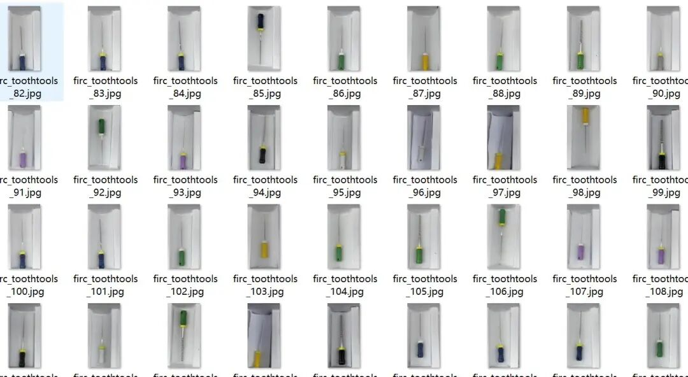
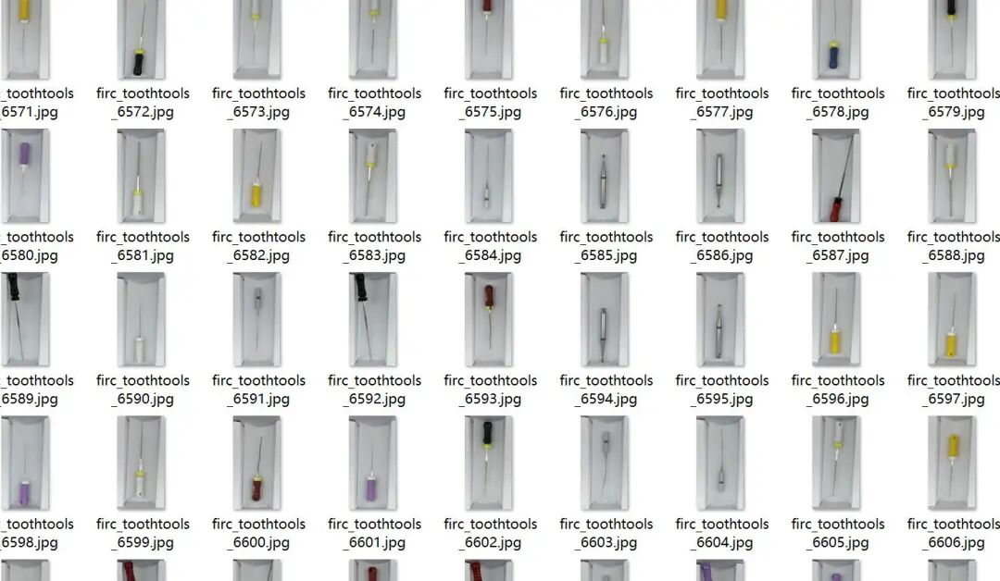
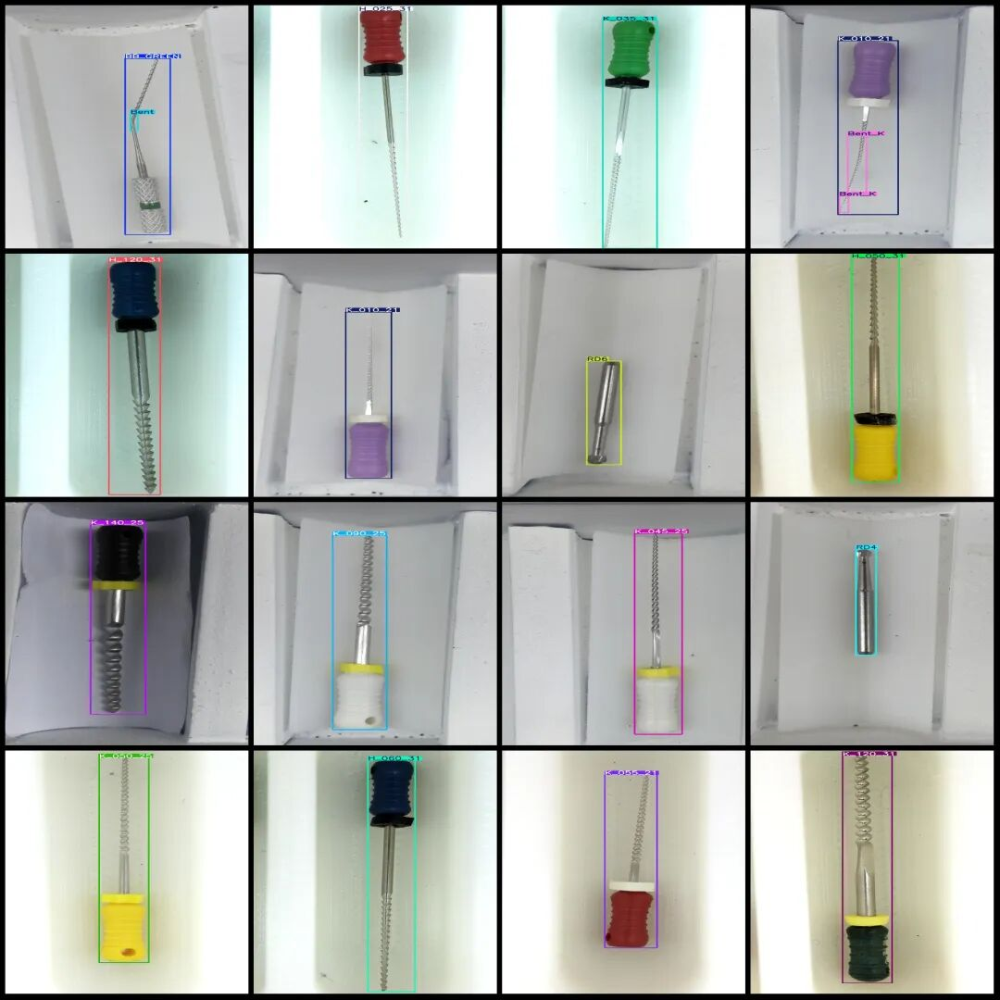
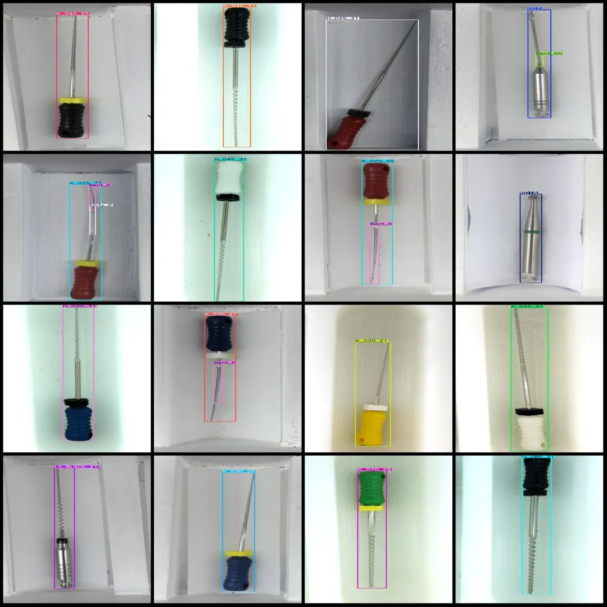

# Intelligent Medical Dental Drill Type Identification Dental Instruments Detection Dataset VOC+YOLO format with 8211 images and 99 categories

Dataset format: Pascal VOC format + YOLO format (txt file without split path, only containing jpg images and corresponding VOC format xml files and yolo format txt files)

Number of images (number of jpg files): 8211

Number of annotations (number of xml files): 8211

Number of annotations (number of txt files): 8211

Labeling category count: 99

The product technical requirements are as follows:

Number of boxes labeled in each category:

AL2 (AL2 type needle) frame count = 36

AL4 (AL4 type) frame count = 103

AL5 (AL5 type needle) frame count = 167

BB_BLUE (Blue Global Diamond) frame count = 98

BB_GREEN (Green Circle)Frame Count = 201

BB_RED (Red Global Diamond) frame count = 83

BB_YELLOW (Yellow Global Drill) frame count = 79

Bent (bending) frame count = 81

Bent_BB (bending ball bit) frame count = 301

Bent_GG (bent GG drill) frame count = 11

Bent_H (bend H file) frame count = 72

Bent_K (Bend K File) Frame Count = 1180

Bent_PC (bending PC drill) frame count = 134

DMD (DMD drill) frame count = 150

Dirty_BB (Dirty Ball Drill) Frame Count = 14

Dirty_DMD (Dirty DMD drill) frame count = 44

Dirty_K (Dirty K File) Frame Count = 133

Dirty_PC (Dirty PC drill)Frame Count = 133

GG2 (GG2 drill) frame count = 71

GG3 (GG3 drill) frame count = 60

GG4 (GG4 drill) frame count = 60

H_015_31 (H File 0.15mm/31mm) frame count = 54

H_020_31 (H File 0.20mm/31mm) frame count = 69

H_025_31 (H File 0.25mm/31mm) frame count = 106

H_030_31 (H File 0.30mm/31mm) frame count = 105

H_035_31 (H File 0.35mm/31mm) frame count = 105

H_040_31 (H File 0.40mm/31mm) frame count = 106

H_045_31 (H File 0.45mm/31mm) frame count = 79

H_050_31 (H File 0.50mm/31mm) frame count = 105

H_055_31 (H File 0.55mm/31mm) frame count = 105

H_060_31 (H File 0.60mm/31mm) frame count = 101

H_070_31 (H File 0.70mm/31mm) frame count = 90

H_080_31 (H File 0.80mm/31mm) frame count = 104

H_090_31 (H File 0.90mm/31mm) frame count = 104

H_100_31 (H File 1.00mm/31mm) frame count = 66

H_110_31 (H File 1.10mm/31mm) frame count = 104

H_120_31 (H File 1.20mm/31mm) frame count = 104

K_008_25 (K file 0.08mm/25mm) frame count = 91

K_010_21 (K file 0.10mm/21mm) frame count = 128

K_010_25 (K file 0.10mm/25mm) frame count = 125

K_010_31 (K file 0.10mm/31mm) frame count = 90

K_015_21 (K file 0.15mm/21mm) frame count = 76

K_015_25 (K file 0.15mm/25mm) frame count = 145

K_015_31 (K file 0.15mm/31mm) frame count = 54

K_020_21 (K file 0.20mm/21mm) frame count = 129

K_020_25 (K file 0.20mm/25mm) frame count = 127

K_020_31 (K file 0.20mm/31mm) frame count = 116

K_025_21 (K file 0.25mm/21mm) frame count = 63

K_025_25 (K file 0.25mm/25mm) frame count = 66

K_025_31 (K file 0.25mm/31mm) frame count = 73

K_030_21 (K file 0.30mm/21mm) frame count = 73

K_030_25 (K file 0.30mm/25mm) frame count = 124

K_030_31 (K file 0.30mm/31mm) frame count = 88

K_035_21 (K file 0.35mm/21mm) frame count = 121

K_035_25 (K file 0.35mm/25mm) frame count = 142

K_035_31 (K file 0.35mm/31mm) frame count = 89

K_040_21 (K file 0.40mm/21mm) frame count = 61

K_040_25 (K file 0.40mm/25mm) frame count = 141

K_040_31 (K file 0.40mm/31mm) frame count = 72

K_045_21 (K file 0.45mm/21mm) frame count = 86

K_045_25 (K File 0.45mm/25mm) frame count = 104

K_045_31 (K file 0.45mm/31mm) frame count = 84

K_050_21 (K file 0.50mm/21mm) frame count = 59

K_050_25 (K file 0.50mm/25mm) frame count = 34

K_050_31 (K file 0.50mm/31mm) frame count = 69

K_055_21 (K file 0.55mm/21mm) frame count = 76

K_055_25 (K file 0.55mm/25mm) frame count = 41

K_055_31 (K file 0.55mm/31mm) frame count = 41

K_060_21 (K file 0.60mm/21mm) frame count = 82

K_060_25 (K file 0.60mm/25mm) frame count = 97

K_060_31 (K file 0.60mm/31mm) frame count = 85

K_070_21 (K file 0.70mm/21mm) frame count = 62

K_070_25 (K file 0.70mm/25mm) frame count = 106

K_070_31 (K file 0.70mm/31mm) frame count = 57

K_080_21 (K file 0.80mm/21mm) frame count = 63

K_080_25 (K file 0.80mm/25mm) frame count = 52

K_080_31 (K file 0.80mm/31mm) frame count = 42

K_090_25 (K file 0.90mm/25mm) frame count = 115

K_090_31 (K file 0.90mm/31mm) frame count = 71

K_100_25 (K file 1.00mm/25mm) frame count = 108

K_100_31 (K file 1.00mm/31mm) frame count = 85

K_110_25 (K file 1.10mm/25mm) frame count = 62

K_110_31 (K file 1.10mm/31mm) frame count = 57

K_120_25 (K file 1.20mm/25mm) frame count = 100

K_120_31 (K file 1.20mm/31mm) frame count = 110

K_130_25 (K file 1.30mm/25mm) frame count = 100

K_140_25 (K file 1.40mm/25mm) frame count = 99

LS_BLACK_21 (Side File - Black Ring 21mm) frame count = 84

LS_BLACK_25 (Side File - Black Ring 25mm) frame count = 98

LS_GREEN_21 (Side File - Green Ring 21mm) frame count = 84

LS_GREEN_25 (Side-cutting - Green Ring 25mm)Frame Count = 124

RD4 (Number 4 Carbon Needle) frame count = 120

RD5 (40)

RD6 (Number 6) frame count = 124

RD7 (46)

RD10 (RD10) frame count = 160

RD14 (RD14) frame count = 189

RD18 (Number 137) frame count = 137

Rusty (rusted) frame count = 281

Total frame count: 10546

Number of images per category:

AL2 (AL2 type needle) holds image count = 36

AL4 (AL4 type needle) holds image count = 103

AL5 (Type AL5) possesses 167 images.

BB_BLUE (Blue Global Diamond) holds 98 images.

BB_GREEN (Green Global Diamond) holds 201 images.

BB_RED (Red Global Diamond) holds 82 images.

BB_YELLOW (Yellow Global Diamond) holds 79 images.

Bent (bending) has 75 images.

Bent_BB (bending ball bit) has 208 images.

Bent_GG (bent GG drill) holds image count = 11

Bent_H (Bend H File) has 38 images.

Bent_K (Bent K File) holds 782 images.

Bent_PC (bent PC drill) holds image count = 122

DMD (DMD drill) holds the image count = 150

Dirty_BB (dirty ball drill) occupies the image count = 14

Dirty_DMD (Dirty DMD drill)occupies 44 images.

Dirty_K (Dirty K File) holds 82 images.

Dirty_PC (Dirty PC drill) has 121 images.

GG2 (GG2 drill) holds the image count = 71

GG3 (GG3 drill) holds picture count = 60

GG4 (GG4 drill) holds the image count = 60

H_015_31 (H File 0.15mm/31mm) has a picture count = 54

H_020_31 (H File 0.20mm/31mm) has a picture count = 69

H_025_31 (H File 0.25mm/31mm) has 106 images.

H_030_31 (H File 0.30mm/31mm) has a picture count = 105

H_035_31 (H File 0.35mm/31mm) has 105 images.

H_040_31 (H File 0.40mm/31mm) has a picture count = 106

H_045_31 (H File 0.45mm/31mm) has a picture count = 79

H_050_31 (H File 0.50mm/31mm) has 105 images.

H_055_31 (H File 0.55mm/31mm) has a picture count = 105

H_060_31 (H File 0.60mm/31mm) has 101 images.

H_070_31 (H File 0.70mm/31mm) has a picture count = 90

H_080_31 (H File 0.80mm/31mm) has 104 images.

H_090_31 (H File 0.90mm/31mm) has a picture count = 103

H_100_31 (H File 1.00mm/31mm) has a picture count = 66

H_110_31 (H File 1.10mm/31mm) has 104 images.

H_120_31 (H File 1.20mm/31mm) has 104 images.

K_008_25 (K File 0.08mm/25mm) has a picture count = 90

K_010_21 (K File 0.10mm/21mm) has 127 images.

K_010_25 (K File 0.10mm/25mm) has 125 images.

K_010_31 (K File 0.10mm/31mm) has a picture count = 90

K_015_21 (K File 0.15mm/21mm) has 76 images.

K_015_25 (K File 0.15mm/25mm) has 145 images.

K_015_31 (K File 0.15mm/31mm) has a picture count = 54

K_020_21 (K File 0.20mm/21mm) has 129 images.

K_020_25 (K File 0.20mm/25mm) has a picture count = 127

K_020_31 (K File 0.20mm/31mm) has 116 images.

K_025_21 (K File 0.25mm/21mm) has a picture count = 63

K_025_25 (K File 0.25mm/25mm) has a picture count = 66

K_025_31 (K File 0.25mm/31mm) has a picture count = 72

K_030_21 (K File 0.30mm/21mm) has a picture count = 73

K_030_25 (K File 0.30mm/25mm) has 124 images.

K_030_31 (K File 0.30mm/31mm) has 88 images.

K_035_21 (K File 0.35mm/21mm) has 121 images.

K_035_25 (K File 0.35mm/25mm) has 142 images.

K_035_31 (K File 0.35mm/31mm) has 89 images.

K_040_21 (K File 0.40mm/21mm) has a picture count = 61

K_040_25 (K File 0.40mm/25mm) has 141 images.

K_040_31 (K File 0.40mm/31mm) has 72 images.

K_045_21 (K File 0.45mm/21mm) has 86 images.

K_045_25 (K File 0.45mm/25mm) has a picture count = 104

K_045_31 (K File 0.45mm/31mm) has 84 images.

K_050_21 (K File 0.50mm/21mm) has a picture count = 59

K_050_25 (K File 0.50mm/25mm) has a picture count = 34

K_050_31 (K File 0.50mm/31mm) has a picture count = 69

K_055_21 (K File 0.55mm/21mm) has a picture count = 76

K_055_25 (K File 0.55mm/25mm) has 41 images.

K_055_31 (K File 0.55mm/31mm) has 41 images.

K_060_21 (K File 0.60mm/21mm) has 82 images.

K_060_25 (K File 0.60mm/25mm) has a picture count = 97

K_060_31 (K File 0.60mm/31mm) has 85 images.

K_070_21 (K File 0.70mm/21mm) has a picture count = 62

K_070_25 (K File 0.70mm/25mm) has 106 images.

K_070_31 (K File 0.70mm/31mm) has 57 images.

K_080_21 (K file 0.80mm/21mm) has a picture count = 63

K_080_25 (K File 0.80mm/25mm) has 52 images.

K_080_31 (K File 0.80mm/31mm) has 42 images.

K_090_25 (K File 0.90mm/25mm) has a picture count = 115

K_090_31 (K File 0.90mm/31mm) has a picture count = 71

K_100_25 (K File 1.00mm/25mm) has 108 images.

K_100_31 (K File 1.00mm/31mm) has a picture count = 85

K_110_25 (K File 1.10mm/25mm) has 62 images.

K_110_31 (K File 1.10mm/31mm) has a picture count = 57

K_120_25 (K File 1.20mm/25mm) has a picture count = 100

K_120_31 (K File 1.20mm/31mm) has 110 images.

K_130_25 (K File 1.30mm/25mm) has a picture count = 100

K_140_25 (K File 1.40mm/25mm) has a picture count = 99

LS_BLACK_21 (Side File - Black Ring 21mm) has occupied the image count = 84

LS_BLACK_25 (Side File - Black Ring 25mm) has a picture count = 98

LS_GREEN_21 (Side Filet - Green Ring 21mm) occupies = 84

LS_GREEN_25 (Side File - Green Ring 25mm) has 124 images.

RD4 (Number 4 Carbon Point) holds the image count = 120

RD5 (Number 5 Carbon Point) holds the image count = 40

RD6 (Number 6 Carbon Point) holds the image count = 124

RD7 (Number 7 Carbon Point) holds the image count = 46

RD10 (Number 160) possesses a picture count = 160

RD14 (RD14) number of the needles = 189

RD18 (Number 18) Needle occupies the image count = 137

Rusty (rust) owns 135 images

Image resolution: 1200x2400

Using labelImg:

Annotation rules: Draw a rectangle around the category.

Important Notice: The dataset does not have separate training, validation, and test sets; you need to partition them yourself.

Special : This dataset does not guarantee the accuracy of the trained models or weight files.

Image Preview:

Annotation example:

## Payment

Here is a pay link on Stripe ( https://buy.stripe.com/3cs8yP7sY87d0vu9AB ). Please contact me lonlonago@foxmail.com after funding $89, and I will send you a complete data files , thank you!

